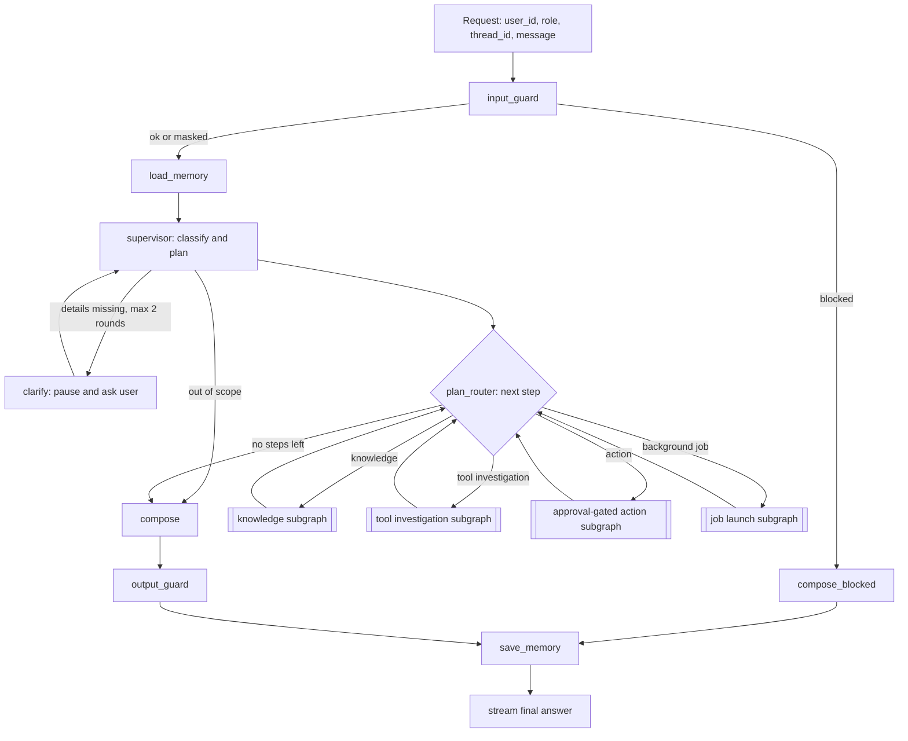
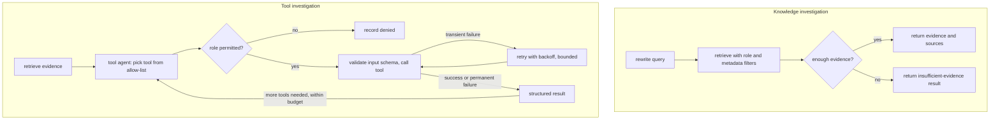
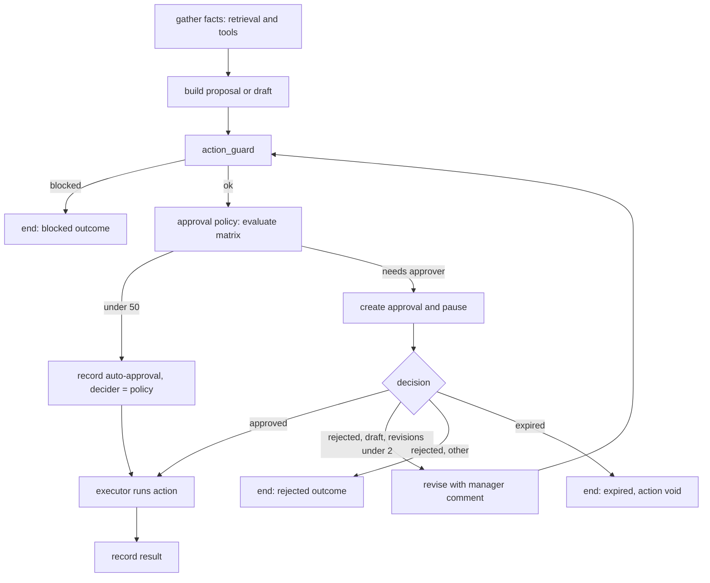
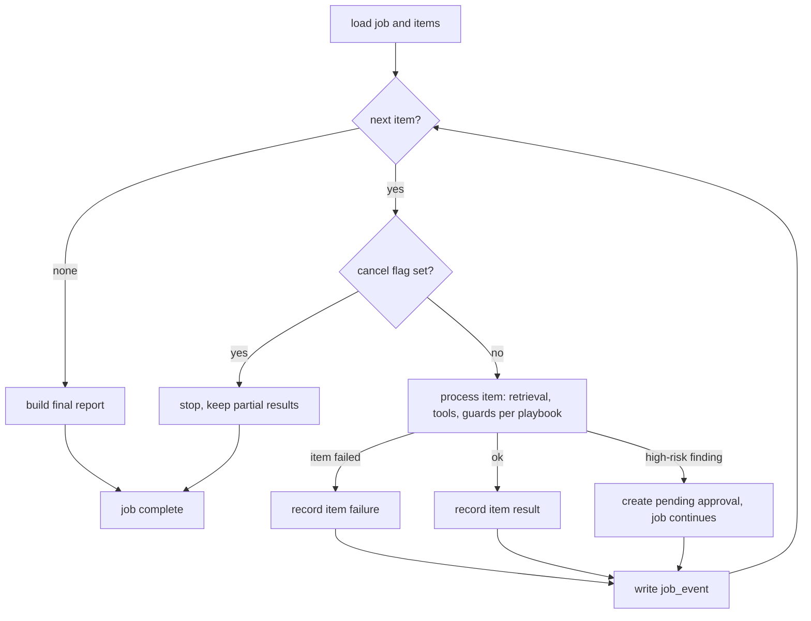
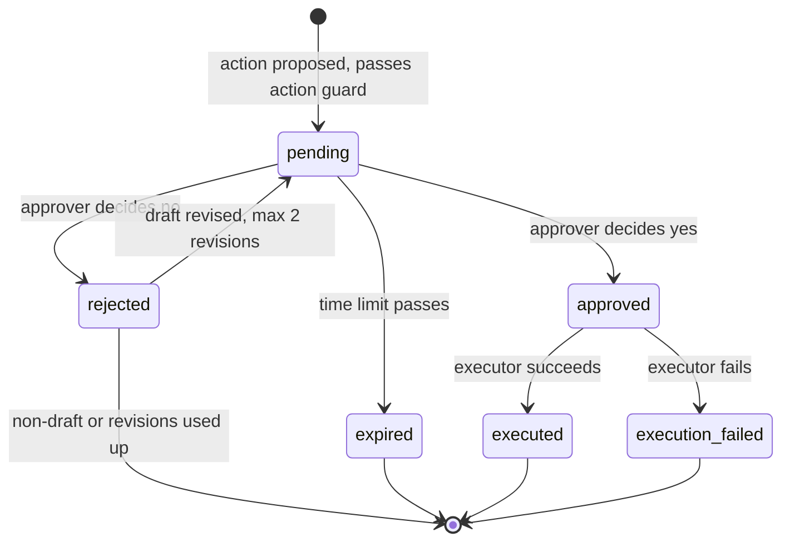
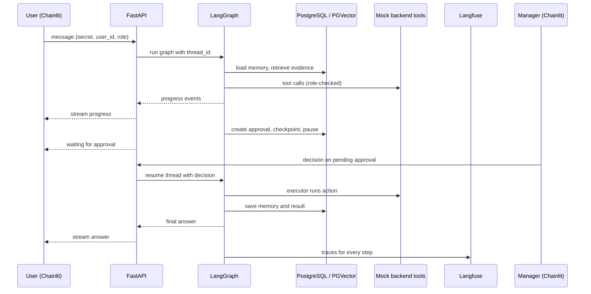

# Enterprise Operations Copilot — Design

Design decisions are recorded here one topic at a time, after being refined in discussion.

## 1. Use Case

### 1.1 Company

**Company X** is a mid-size online marketplace (about 2,000 employees). Customers buy from sellers, and the company handles payments, refunds, and disputes itself. It has a paid premium membership with priority service levels.

### 1.2 Purpose

A single internal copilot that lets support, compliance, operations, and manager roles:

- investigate cases and answer questions with evidence from internal documents,
- combine that evidence with data from internal systems,
- draft responses, notes, and actions,
- route high-risk actions to a manager for approval,
- run long batch work in the background.

The copilot is an **advisor and drafter**. It acts on its own only through approved low-risk tools. Anything high-risk waits for a human decision.

### 1.3 Roles

| Role | Typical work | Approver? |
|---|---|---|
| Support agent | Case investigation, customer replies, escalation notes | No |
| Compliance analyst | Policy checks, PII review, scans, fraud review | No |
| Operations specialist | Approval delays, triage, incidents, ownership lookup | No |
| Manager | Reviews and decides on high-risk actions | Yes |

Roles determine which tools and data a user can reach. Only managers (within the limits of the approval matrix) can approve.

### 1.4 Scenarios

**Support**

- Refund status investigation.
- Duplicate or wrong charge dispute.
- Draft a customer reply.
- Ticket summary and escalation note.

**Compliance**

- Policy violation check.
- PII and data-privacy review.
- Bulk compliance scan (background).
- Suspicious activity / fraud flag.

**Operations**

- Delayed approval investigation.
- Batch ticket triage (background).
- Incident runbook lookup.
- Organization and owner lookup.

**Cross-team core flows**

1. **Delayed premium refund.** Support investigates, operations locates the stuck approval, compliance checks policy, a manager approves a refund or exception.
2. **Dispute to fraud flag.** A duplicate-charge dispute reveals a suspicious pattern; compliance reviews; flagging the account needs approval.
3. **Daily P1 triage to escalation.** A background batch triages cases and prepares escalation notes; high-risk items go to managers.

### 1.5 High-risk actions (manager approval)

- Issue a refund above the threshold.
- Send customer communication.
- Grant a policy exception.
- Escalate or flag an account.

### 1.6 Business rules

**Refund approval ladder (USD)**

| Amount | Handling |
|---|---|
| Under 50 | Within standard policy; no approval (automatic approval recorded, decider = policy) |
| 50 and over | Manager approval |

All non-refund high-risk actions (customer communication, policy exception, account escalation or flag) also require manager approval. A requester can never approve their own request; if the requester is a manager, another manager decides. The seeded users therefore include at least two managers.

**Premium membership.** Paid membership. Refund SLA of 24 hours versus 5 business days for standard customers, plus priority support routing.

**Ticket priority and SLA**

| Priority | Meaning | Response SLA |
|---|---|---|
| P1 | Critical (payment outage, fraud) | 1 hour |
| P2 | High | 4 hours |
| P3 | Normal | 1 business day |
| P4 | Low | 3 business days |

**Fraud / suspicious-activity signals (mock data)**

- Repeated duplicate-charge disputes from the same customer in a short window.
- Refund velocity (unusually many or large refunds on one account or seller).
- Identity details in a ticket that do not match the customer record.

### 1.7 Systems and tools

The copilot reaches company data through approved tools. The systems behind them are mock services in one container, seeded reproducibly, and exposed over HTTP so tool calls, retries, and failures are real.

| Tool | Backing system | Data |
|---|---|---|
| Ticket lookup | Ticketing system | customers, tickets, ticket_events |
| Transaction lookup | Orders / payments / refunds ledger | orders, payments, refunds |
| Policy lookup | Knowledge base | documents, document_chunks, structured thresholds |
| Org lookup | Org directory and approval matrix | employees, org_units, approval_matrix |
| Approval submission | Copilot's own approvals store | approvals |
| Notification / draft | Notification service | drafts, outbox (send only after approval) |

The handout's five tools plus transaction lookup, which covers the refund, dispute, and fraud flows.

The mock data and the policy documents must state the same facts (premium definition, thresholds, SLAs), and the data must contain the situations the core flows need: stuck premium refunds, a duplicate-charge pattern, a P1 batch, an approval matrix with real thresholds, and a draft that contains PII.

### 1.8 Data sources

- **BANKING77:** routing and supervisor evaluation. Keep about 30 intents that fit an e-commerce company (payments, refunds, charges, disputes, fraud, identity). Intents that don't fit become out-of-scope routing tests.
- **Enron emails:** role to be decided during data pipeline design (candidate: historical communications archive for search, incident reconstruction, and compliance scans).
- **Synthetic enterprise documents:** at least 25 Company X documents (policies, SOPs, runbooks, approval matrix, privacy guidance, org directory), with versions.

### 1.9 High-level objectives

1. Route each request to the correct workflow.
2. Give answers grounded in cited sources, separating evidence from inference.
3. Use tools safely, within the user's role.
4. Never run a high-risk action without a recorded approval.
5. Run long work in the background with visible progress.
6. Stream progress and results to the user.
7. Make every decision traceable: what was done, why, and where it failed.
8. Save investigation time for support, compliance, and operations staff.

### 1.10 Low-level objectives

Targets are proposals to be confirmed during evaluation design.

| Area | Objective |
|---|---|
| Routing | Correct workflow selected on the BANKING77-derived set and the scenario suite; out-of-scope requests detected |
| Grounding | Every factual claim in an answer maps to a retrieved source; unsupported claims are labeled as inference |
| Tools | Inputs and outputs schema-validated; transient failures retried; permanent failures reported in a structured way |
| Approvals | 100% of high-risk actions gated; approve, reject, and expire all handled; workflow resumes only after a valid decision |
| Async | Background jobs survive restarts, report progress, and return failure details |
| Guardrails | Prompt injection, PII, and restricted actions detected; blocked or redacted before any action |
| Observability | Every request has a trace with model calls, retrieval, tools, latency, tokens, and cost |
| Time saved | Investigation steps that normally involve several systems complete in one request |

### 1.11 Out of scope

- Replacing production identity, access control, or audit systems.
- Fully autonomous decisions on high-risk actions.
- A general-purpose enterprise search product.
- Real integrations with external systems (all backing systems are mock).

### 1.12 Open items

- Confirm that refunds under 50 execute without approval, within the advisor-and-drafter model (which tool performs the refund, and does the copilot call it directly).
- Decide the role of the Enron corpus (data pipeline design).
- Confirm the intent subset and the mapping of BANKING77 intents to department, priority, and risk.
- Define how roles are assigned to users (identity decision).

## 2. User Interface and Authentication

### 2.1 Approach

A ready-made chat UI, with no custom frontend. The UI exists to exercise the platform; the FastAPI backend is the product.

**Tool: Chainlit.** It provides a chat box with streamed output and visible intermediate steps, a sidebar of past conversations, a login screen, and action buttons, all without frontend code.

### 2.2 Screen

- **Chat area:** text input and streamed responses. Progress steps appear as they happen (classification, retrieval, tool calls, waiting for approval, completion).
- **Left sidebar:** past conversations, each tied to a session or case.
- **Pending approvals:** a manager sees pending items with approve and reject buttons, inline in the chat.
- **Background jobs:** running and finished jobs appear as progress messages in the conversation.
- **Identity:** the logged-in user's name and role are shown.

### 2.3 Authentication

**Password login against a seeded `users` table.**

- Four demo users, one per role (support, compliance, operations, manager), with hashed passwords and a stored role.
- Chainlit's password callback validates credentials against Postgres.
- The role decides which tools and data the user can reach, and whether they can approve.
- Seeded users make role switching easy, which is needed to demonstrate permissions and approvals.

**Why not OAuth now:** it needs an external OAuth app, client secrets, internet access, and a real account per demo user, which conflicts with a one-command start. The API only receives `user_id` and `role`, so OAuth or SSO can replace the login callback later without touching the backend.

### 2.4 UI to API trust

- The UI runs as its own container and calls FastAPI over HTTP and SSE.
- After login, the UI calls the API with a shared secret plus `user_id` and `role` headers. The API accepts only calls that carry the secret.
- This is not production identity; the production design (signed tokens issued by an identity provider) is described in the write-up.

### 2.5 Conversation history

- Chainlit stores conversation history in the same PostgreSQL instance, in a separate schema.
- A Chainlit thread maps one-to-one to a `sessions` row and the LangGraph checkpoint `thread_id`, so history is not kept twice.

### 2.6 Pending approvals

The approver is a different person from the requester, so approvals cannot depend on a button inside the requester's conversation. Approvals live in the database and are exposed by the API (`GET /approvals?status=pending`, `POST /approvals/{id}/decision`).

- **Manager view:** a `/approvals` command lists pending items, each with Approve and Reject buttons and the evidence needed to decide. At login (and on opening a chat), a message such as "You have N pending approvals" links to the same list.
- **Requester view:** the conversation shows "waiting for approval" and is updated with the decision when it arrives.
- **Fallback:** Chainlit's left sidebar is not extensible to my knowledge. A short spike confirms what is possible; if `/approvals` or its buttons hit a limit, approvals appear inline in the manager's open chat.

### 2.7 Conversation management

Past conversations are listed and reopened only. Delete and rename are not supported in this phase.

### 2.8 Job progress and returning users

- Each job writes an append-only `job_events` stream (sequence number, stage, message, timestamp). The job's final result and any failure details are stored on the job record.
- The stream endpoint accepts "events after N": it replays missed events, then continues live.
- When a past conversation is opened, the UI lists the jobs linked to its thread, re-attaches to running ones, and renders results of finished ones.
- A `/jobs` command lists the user's recent jobs and their status.
- The worker cannot push into a conversation the user is not viewing, so results are delivered on the next open.

### 2.9 Decision notification

When a manager decides, the workflow resumes immediately. The requester sees the decision live if the conversation is open, otherwise when it is next opened. Out-of-band notification (email, push) is out of scope for this phase.

## 3. Workflows, Agents, Tools, and Graph

### 3.1 Principles

- One LangGraph orchestration graph. The supervisor is a **router**: it classifies a request into known workflows (structured output) and the graph follows predefined paths. Deterministic paths are easier to test, trace, and gate than free-form agent handoffs.
- Agents are **mostly deterministic**; an LLM is used only where judgment or language is required.
- Retrieved text and tool results are **untrusted input** at every step.
- High-risk actions are executed only by internal executors after a recorded decision. The LLM never calls them.

### 3.2 Graph outline

```
request -> input guard -> load memory -> supervisor (classify + plan)
   |- out of scope / blocked ----------------------------> compose
   |- knowledge investigation: retrieval ----------------> compose
   |- tool investigation: retrieval + tools -------------> compose
   |- approval-gated action: retrieval/tools -> action guard
   |       -> approval pause -> executor -> compose
   |- background job: create job -> worker (batch subgraph) -> progress events -> result
compose -> output guard -> save memory -> stream answer
```

A request may produce an **ordered plan** of workflow steps drawn from the fixed set (for example: tool investigation, then an approval-gated draft). The graph executes the steps in order.

### 3.3 Agents

| Agent | Implementation | Responsibility |
|---|---|---|
| Supervisor | LLM, structured output | Classify, build the plan, decide retrieval / tools / approval / background; ask a clarifying question when details are missing (at most two rounds) |
| Retrieval | Query rewrite (LLM) + metadata-filtered vector search | Evidence with sources and filters |
| Memory | Deterministic service; LLM only to summarize | Load and save conversation summary, case state, entities, workflow state |
| Tool Execution | LLM tool-calling restricted to the playbook's allow-list and the user's role | Schema-validated calls, retries, structured results and failures |
| Compliance | Rules plus LLM classifier | Input, action, and output checks (see 3.7); block, redact, or restrict |
| Approval | Deterministic | Evaluate the approval matrix, create and persist the approval, pause, resume on decision, invoke the executor |
| Response Composer | LLM | Grounded answer, summary, recommendation, or draft; evidence separated from inference |

### 3.4 Workflows and playbooks

Five generic workflows. Each scenario from section 1 is a **playbook**: configuration that sets the tool allow-list, required evidence, and output template.

| Workflow | Used by scenarios |
|---|---|
| Knowledge investigation | Policy violation check, incident runbook lookup, org and owner lookup, ticket summary |
| Tool investigation | Refund status, duplicate or wrong charge dispute, delayed approval investigation, suspicious activity review |
| Approval-gated action | Draft customer reply, refund above threshold, policy exception, escalation or account flag |
| Background job | Bulk compliance scan, batch ticket triage |
| Guardrailed path | Any request blocked, redacted, or restricted (for example PII review) |

### 3.5 Tools and permissions

Read tools: ticket lookup, transaction lookup, policy lookup, org lookup. Write tool callable by the LLM: draft creation (writes a draft only). Approval submission is performed by the Approval agent, not chosen by the LLM.

**Action executors** (not LLM-callable, invoked only by the Approval agent after a decision): issue refund, send communication, grant policy exception, escalate or flag account.

Role-specific access:

| Capability | Support | Compliance | Operations | Manager |
|---|---|---|---|---|
| Ticket lookup | Yes | Yes | Yes | Yes |
| Transaction lookup | Customer-scoped | Yes | Yes | Yes |
| Fraud signals (within transaction and ticket data) | No | Yes | No | Yes |
| Policy lookup | Yes | Yes | Yes | Yes |
| Org lookup | Yes | Yes | Yes | Yes |
| Create customer draft | Yes | No | No | Yes |
| Create internal escalation note | Yes | Yes | Yes | Yes |
| Launch compliance scan | No | Yes | No | Yes |
| Launch batch triage | No | No | Yes | Yes |
| Approve high-risk actions | No | No | No | Yes (never their own request) |

Permissions are enforced in the tool layer from the `role` supplied by the API, not by prompts.

### 3.6 Approval lifecycle

- Refund approval ladder from section 1.6. Under 50: the policy records an automatic approval (decider = policy) and the executor runs, so every action has an audit row. 50 and over, and all non-refund actions: a manager approves, and never the requester.
- A pending approval stores the proposed action, evidence, requester, required approver level, and an expiry time. The graph pauses via a LangGraph interrupt with the Postgres checkpointer.
- **Approve:** the executor runs and the workflow resumes.
- **Reject:** drafts (customer communication, escalation notes, exception requests) loop back to the composer with the manager's comment, up to two revisions. Non-draft actions (refund, account flag) end with a recorded outcome.
- **Expire:** the approval is marked expired and the pending action is void.

### 3.7 Guard points

1. **Input guard:** validation, prompt-injection detection, PII detection and masking, restricted-request detection, before routing.
2. **Action guard:** policy and compliance check on a proposed action before approval or any write.
3. **Output guard:** output validation, PII redaction, groundedness check, before the user sees the answer.

### 3.8 Background jobs

- Launched by the supervisor, run by a worker as a separate graph run (batch subgraph).
- Per-item results: one item failing does not abort the job; the final report lists failures.
- The user can cancel a running job; the flag is checked between items and partial results are kept.
- Progress and state persist, so an interrupted job resumes from the last completed item after a worker restart.
- High-risk findings inside a job (for example an escalation) become pending approvals instead of acting.

### 3.9 Open items

- Playbook definitions (one per scenario).

### 3.10 Graph structure

**One graph serves every role.** The role is an input that restricts tools, data, and approval rights; it never selects a different graph. The request content selects the path: the supervisor emits a plan, and conditional edges follow it.

- **Main graph:** guards, memory, supervisor, plan loop, compose. Compiled with the Postgres checkpointer; one `thread_id` per conversation.
- **Five workflow subgraphs** inside the main graph: knowledge investigation, tool investigation, approval-gated action, background job launch, and the guardrailed path (the blocked branch).
- **Batch job graph:** a separate graph run by the worker for background work.
- **Plan loop:** state holds the ordered plan and a step pointer. After each workflow subgraph finishes, control returns to the plan router, which dispatches the next step; when no steps remain, the response is composed once.
- **Manager entry point:** `/approvals` calls the decision endpoint, which resumes the paused graph. It is not a separate workflow.

### 3.11 Main graph



### 3.12 Workflow subgraphs





### 3.13 Batch job graph (worker)



### 3.14 Approval lifecycle



Under-50 refunds skip `pending`: they are recorded as `approved` with decider = policy, then executed.

### 3.15 One request, end to end



### 3.16 Decisions in this section

- Workflow paths are LangGraph subgraphs inside one main graph.
- Multi-step plans run as a loop over plan steps with a step pointer in state.
- The graph is the same for all roles; the role limits tools, data, and approval rights.

## 4. Reliability and Production Hardening

### 4.1 Resilience mechanisms

| Mechanism | Purpose |
|---|---|
| Timeouts | Bound every call: per call, per graph node, per request or job |
| Retry with exponential backoff and jitter | Recover from transient errors; jitter prevents synchronized retries |
| Circuit breaker | Stop calling a failing dependency. States: closed (normal, failures counted), open (calls fail immediately), half-open (trial calls after a cool-down decide whether to close or reopen) |
| Fallback | A degraded but useful result when a dependency is unavailable |
| Rate limits and budgets | Protect against overload and runaway cost |

### 4.2 Application per dependency

| Dependency | Retry | Breaker | Fallback |
|---|---|---|---|
| OpenAI chat | Yes; honor `Retry-After` on rate-limit responses | Yes | None: fail clearly with a "model unavailable" response (no alternate model) |
| OpenAI embeddings | Yes | Yes | Ingestion is queued and retried; for queries, return a clear error |
| Mock backend read tools | Yes | One per tool | Report "tool unavailable", continue with gathered evidence, and label the gap in the answer |
| Action executors | Only with an idempotency key | Yes | None: the action stays pending and visible |
| Langfuse | No blocking | Yes | Export asynchronously; never block or fail a request |
| PostgreSQL | Short retry on connection errors | No | Fail with a clear error (system of record) |

Rules:

- Retry only safe operations: reads freely, writes only with an idempotency key.
- An open breaker prevents the attempt, so retries do not pile on.
- Retries stay inside the node's timeout, so total time is bounded.
- LangGraph per-node retry policies carry most of this; breakers are a thin wrapper around dependency clients.
- Failures are visible: the stream reports degraded steps (for example "ticket system unavailable, continuing without it") and the trace records them.

### 4.3 Rate limits and budgets

- **Per user:** token-bucket limit on requests per minute; daily LLM cost ceiling.
- **Per request:** maximum LLM calls, tool calls, tokens, and wall-clock time.
- **Per job:** maximum items and duration; cancel supported.
- **Storage:** Redis holds the counters and the shared circuit-breaker state, so limits and breakers behave consistently across API and worker instances.

Redis is therefore part of the stack (an optional service in the handout). Whether it also serves as the background job queue (RQ or Celery) is decided in the async design.

### 4.4 Idempotency

- Every proposed action has an `action_id`, created with the approval.
- Executors check `action_id` before running and record the outcome, so a retry, a resume after a crash, or a duplicate decision cannot execute an action twice.

### 4.5 Audit log

- Append-only table, no updates or deletes.
- Records for each action: requester, role, request and evidence references, guard results, approval decision and decider, executor result, timestamps, and the prompt, playbook, and policy versions used.

### 4.6 Versioned prompts, playbooks, and policies

- Prompts, playbooks, and policy thresholds are files in the repository, each with a version and content hash.
- Version identifiers are recorded on every trace and every approval, so any outcome ties to the exact versions that produced it.
- Evaluation results are reported per version, so a prompt change that lowers routing accuracy or groundedness is visible.

### 4.7 Knowledge path

The knowledge-investigation path may use a bounded agent loop (maximum rounds, fixed budget) if evaluation shows retrieval needs more than one search round. Default is a single retrieval pass.

### 4.8 Initial limits (configuration defaults)

These are starting values held in configuration, not code, and are expected to change after evaluation and load testing.

```yaml
timeouts_seconds:
  llm_call: 30
  embedding_call: 15
  tool_call: 10
  db_query: 5
  graph_node_default: 60
  request_total: 120        # excludes approval waits and background jobs
  job_item: 120
  job_total: 1800
  approval_expiry: 86400    # 24 hours

retries:                     # exponential backoff with full jitter
  llm:        {attempts: 3, base_seconds: 1.0, factor: 2, max_seconds: 20}
  embedding:  {attempts: 5, base_seconds: 1.0, factor: 2, max_seconds: 30}
  read_tool:  {attempts: 3, base_seconds: 0.5, factor: 2, max_seconds: 5}
  executor:   {attempts: 3, base_seconds: 1.0, factor: 2, max_seconds: 10}   # idempotency key required
  db:         {attempts: 2, base_seconds: 0.2, factor: 2, max_seconds: 1}

circuit_breaker:             # one breaker per dependency
  failure_rate_threshold: 0.5
  window_calls: 10
  min_calls: 5
  consecutive_failures_threshold: 5
  open_seconds: 30
  half_open_trial_calls: 3
  half_open_successes_to_close: 2

request_budgets:
  llm_calls: 12
  tool_calls: 8
  total_tokens: 40000
  plan_steps: 4
  clarification_rounds: 2
  draft_revisions: 2
  retrieval_rounds: 1        # up to 3 if the bounded knowledge loop is enabled

rate_limits:
  per_user_requests_per_minute: 20
  per_user_burst: 5
  per_user_daily_cost_usd: 2.00
  per_user_concurrent_jobs: 2
  global_concurrent_graph_runs: 10

jobs:
  max_items: 500
  heartbeat_seconds: 15
  lease_seconds: 60
```

### 4.9 Background job queue decision

**The job queue is a PostgreSQL table, not Redis, RQ, or Celery.**

- Job state, progress, and results must survive restarts, so they live in Postgres regardless. A separate broker would create a second record of "which jobs exist" that can disagree with the first after a crash.
- Redis is not durable by default and can lose recent writes; it suits counters and breaker state, where loss is harmless, but not a job queue.
- Workers claim jobs with `SELECT ... FOR UPDATE SKIP LOCKED` and hold a lease renewed by a heartbeat. If a worker dies, the lease expires, the job is claimed again, and it resumes from the last completed item.
- Postgres data sits on a Docker volume, so jobs persist across container restarts and machine restarts.
- Throughput is not a constraint at this scale. Upgrade paths if it becomes one: Celery or Temporal.

### 4.10 Data inventory

| Data | Store |
|---|---|
| Documents, chunks, embeddings | PostgreSQL / PGVector |
| Sessions, cases, approvals, audit log, users | PostgreSQL |
| Jobs, job events, job queue | PostgreSQL |
| LangGraph checkpoints | PostgreSQL |
| Chainlit history, mock enterprise data | PostgreSQL, separate schemas |
| Rate-limit counters, circuit-breaker state | Redis (ephemeral) |
| Prompts, playbooks, policy thresholds | Repository files, versioned |
| Traces, cost, evaluation signals | Langfuse (see observability design) |

Result: one database engine (PostgreSQL) for everything durable, and Redis only for ephemeral state.

### 4.11 Observability hosting decision

**Langfuse Cloud (free Hobby tier) only.** No self-hosted Langfuse in the Compose stack.

- The stack stays small: app, UI, worker, PostgreSQL, Redis.
- Self-hosted Langfuse needs several additional services (web, worker, ClickHouse, object storage, its own databases) and substantial memory, which is not justified here.
- Configuration is three environment variables (host, public key, secret key). The app does not care which host serves them.
- The app never depends on Langfuse: trace export is asynchronous behind a circuit breaker, so an outage cannot fail a request (see 4.2).
- Only mock and public data is sent to the cloud.
- Hobby tier limits to design around: 50k billable units per month, 30 days retention, 2 users, and low API rate limits (about 30 requests per minute on the general APIs), so evaluation reports should be pulled in batches and results stored in our own database, not re-read from Langfuse.
- A reviewer needs their own free Langfuse keys, supplied in `.env`.

Production note for the write-up: real case data and customer details must not leave the company, so production uses self-hosted Langfuse inside the company network (or an equivalent in-house tracing backend).

### 4.12 Out of scope for this phase

Documented in the write-up as future work, not designed here:

- Real identity: SSO and signed tokens.
- Multi-instance scaling and queue back-pressure.

Cross-organization (per-tenant) isolation is not required: Company X is the only organization.

### 3.17 Graph state

**Principle:** LangGraph checkpoints state at every step, so state stays small and serializable. It carries IDs, flags, short summaries, and bounded excerpts. Facts live in PostgreSQL; the state points to them.

| Group | Fields |
|---|---|
| Identity | `thread_id`, `session_id`, `request_id`, `user_id`, `role`, `case_id` (nullable) |
| Input | `user_message`, `masked_message`, `input_guard` (status, flags) |
| Memory | `messages` (last N turns), `conversation_summary`, `case_snapshot` (small), `entities` |
| Plan | `intent`, `plan` (steps: workflow, playbook id, status), `step_index`, `clarification_rounds`, `pending_question` |
| Working data | `evidence` (chunk id, document id and version, score, bounded excerpt), `tool_results` (tool, call id, status, short summary) |
| Action | `proposal` (action id, type, parameters, amount, draft reference), `action_guard`, `approval` (id, status, decider, comment), `revision_count` |
| Job | `job_id` |
| Budgets | `llm_calls`, `tool_calls`, `tokens`, `cost_usd` |
| Output | `draft_answer`, `final_answer`, `citations`, `output_guard` |
| Versions | `prompt_version`, `playbook_version`, `policy_version` |
| Degradation | `degraded` (notes such as "ticket system unavailable") |

**Rules**

- **Payloads by reference.** State holds IDs and bounded excerpts. Full tool inputs and outputs are written to a `tool_calls` table (also used for audit and tracing); full chunk text is read from `document_chunks` when needed.
- **Conversation history.** The last N turns stay verbatim in `messages`; older turns are folded into `conversation_summary` by the Memory agent. The full transcript is stored in the conversation tables and shown by the UI, not carried in state.
- **Cases.** A thread has an active `case_id` that can change. A case is opened or linked when a ticket or customer is mentioned; if the user moves to another ticket, the thread's active case switches. Entities and notes accrue on the case row, so they persist across threads and sessions.
- **Streaming.** Progress events are emitted to the stream and the job event log; they are not stored in state.
- **Audit.** Anything needed for audit (guard results, approval decisions, executor results, versions) is also written to the audit table; state is not the audit record.
- **Resume safety.** Everything needed to continue after a pause is in state or reachable from it by ID (`approval.id`, `proposal.action_id`, `job_id`). No in-process objects are kept in state.
- **Bounds (configuration defaults):** excerpt length 500 characters, verbatim turns N = 6, evidence items per request 8, tool result summary 300 characters.

**Tables the state points to:** `sessions`, `cases`, `approvals`, `jobs`, `tool_calls`, `document_chunks`, `audit_log`.

