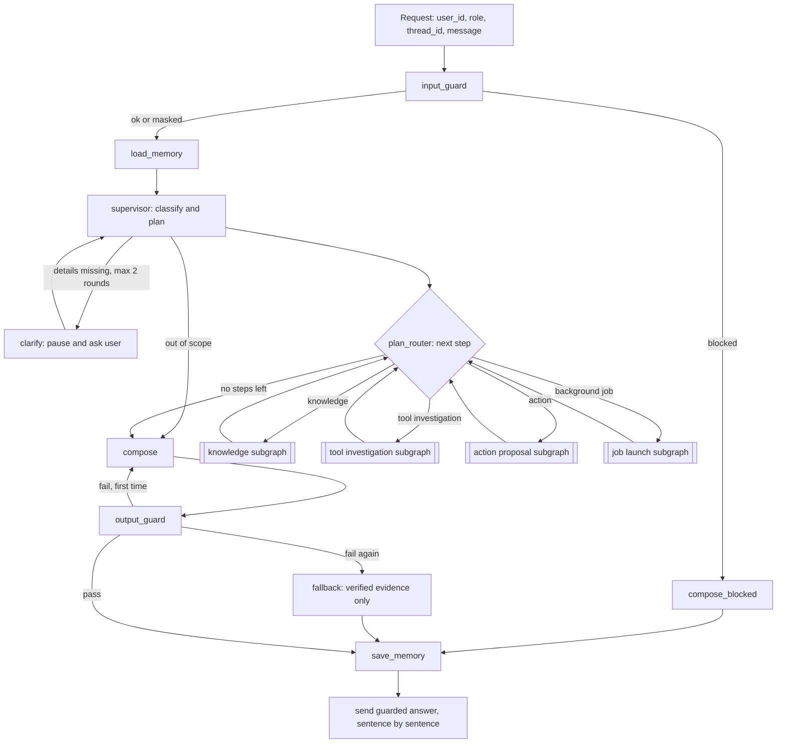
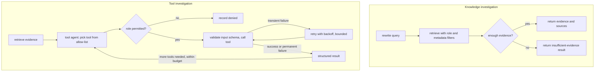
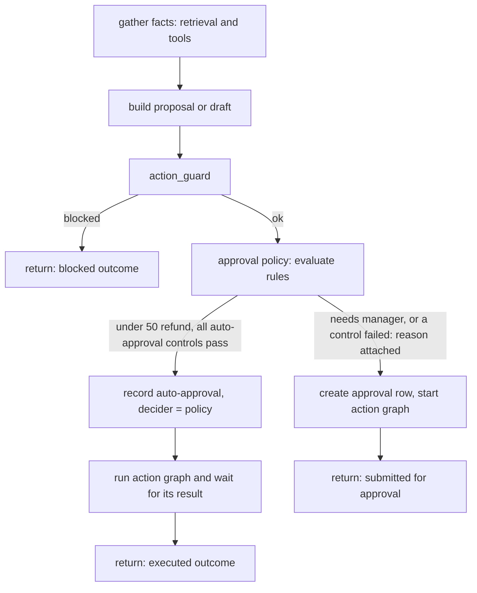
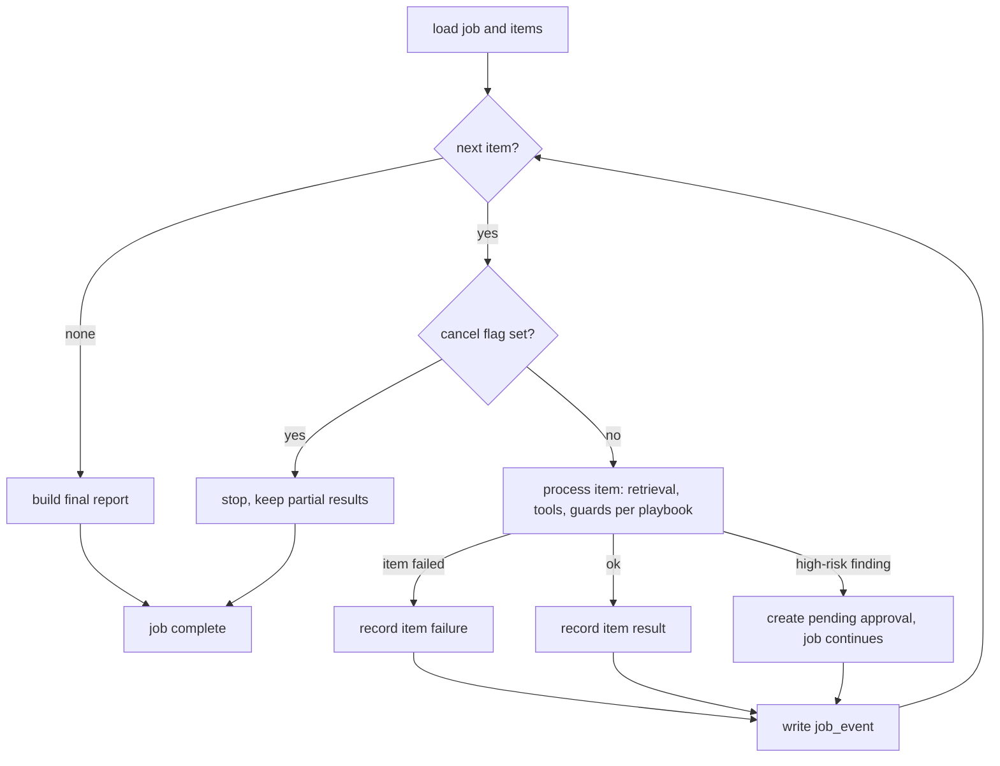
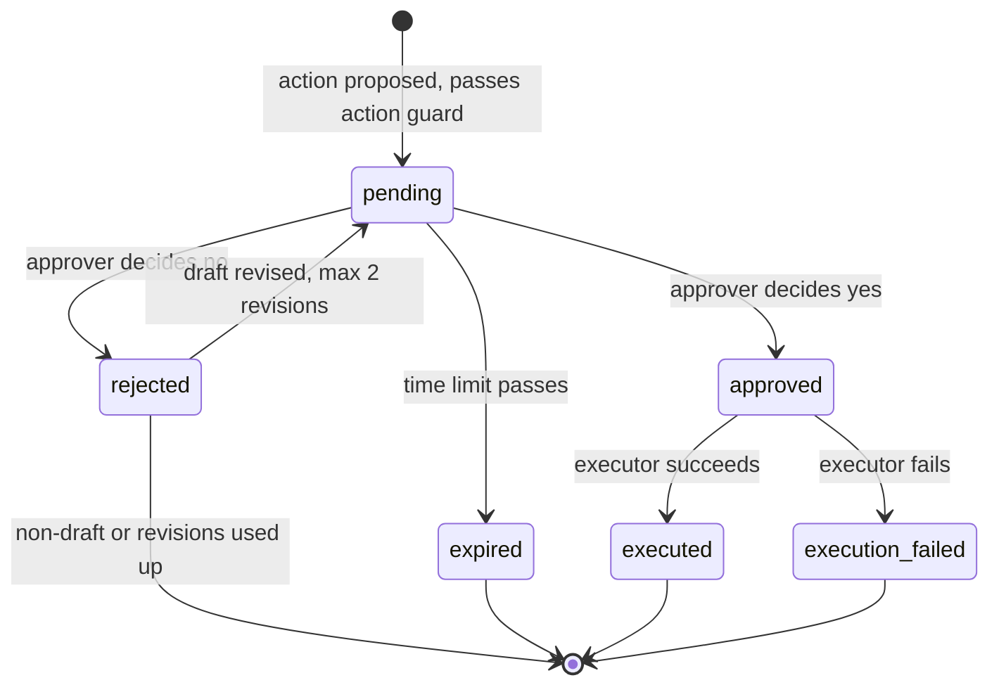
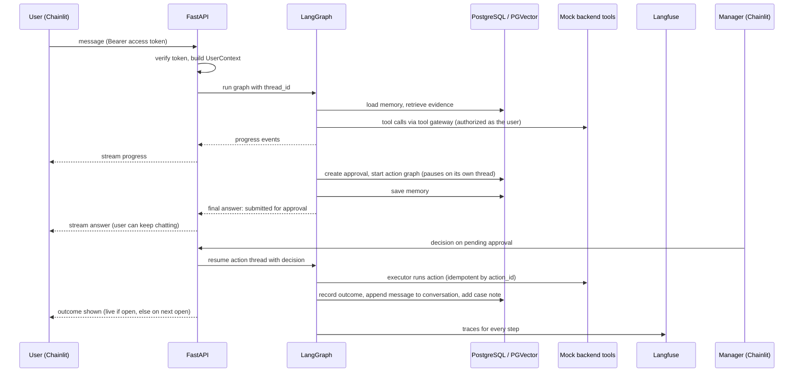
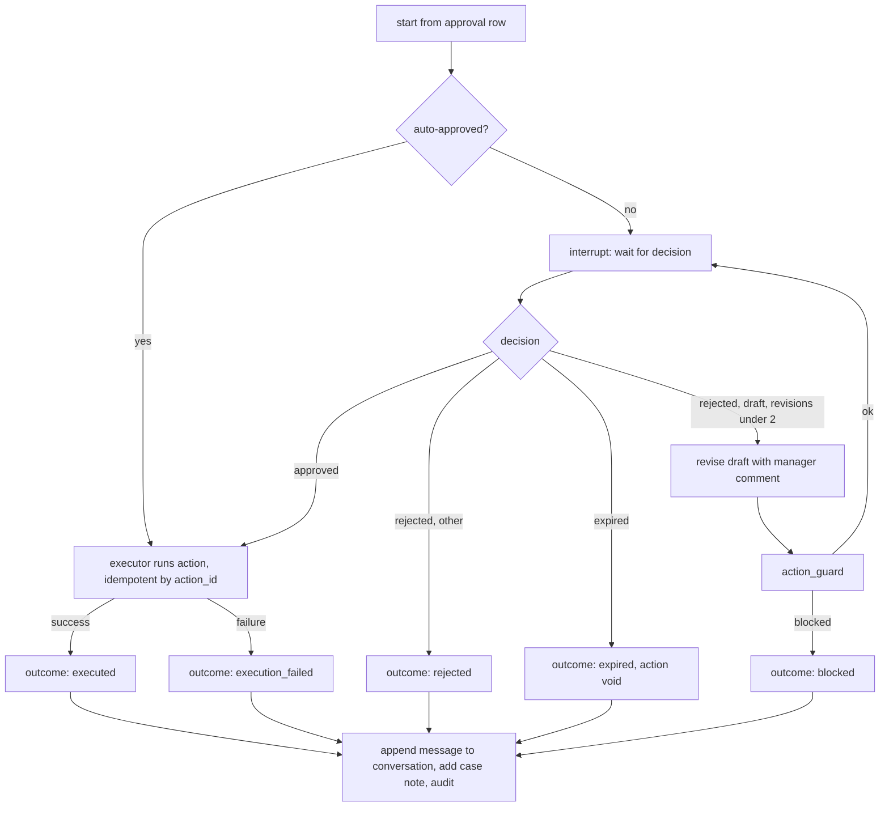
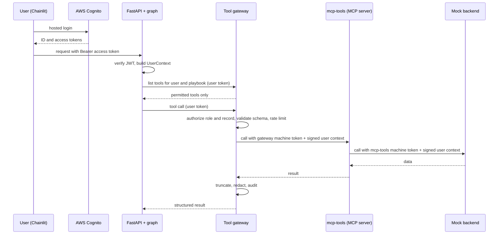

# Enterprise Operations Copilot — Design

Design decisions are recorded here one topic at a time, after being refined in discussion.

## 1. Use Case

### 1.1 Company

**Company X** is a mid-size online marketplace (about 2,000 employees). Customers buy from sellers, and the company handles payments, refunds, and disputes itself. It has a paid premium membership with priority service levels.

### 1.2 Purpose

A single internal copilot that lets support, compliance, operations, and manager roles:

- investigate cases and answer questions with evidence from internal documents,
- combine that evidence with data from internal systems,
- draft responses, notes, and actions,
- route high-risk actions to a manager for approval,
- run long batch work in the background.

**Users are employees only.** Customers never log in or talk to the copilot. They appear as the subject of the data (whose tickets, orders, and refunds are viewed) and as authors of content the copilot reads (ticket text, dispute notes, emails). That content is untrusted: a customer could plant instructions in a ticket that the copilot later reads on an employee's behalf.

The copilot is an **advisor and drafter**. It acts on its own only through approved low-risk tools. Anything high-risk waits for a human decision.

### 1.3 Roles

| Role | Typical work | Approver? |
|---|---|---|
| Support agent | Case investigation, customer replies, escalation notes | No |
| Compliance analyst | Policy checks, PII review, scans, fraud review | No |
| Operations specialist | Approval delays, triage, incidents, ownership lookup | No |
| Manager | Reviews and decides on high-risk actions | Yes |

Roles determine which tools and data a user can reach. Only managers can approve, and never their own request.

### 1.4 Scenarios

**Support**

- Refund status investigation.
- Duplicate or wrong charge dispute.
- Draft a customer reply.
- Ticket summary and escalation note.

**Compliance**

- Policy violation check.
- PII and data-privacy review.
- Bulk compliance scan (background).
- Suspicious activity / fraud flag.

**Operations**

- Delayed approval investigation.
- Batch ticket triage (background).
- Incident runbook lookup.
- Organization and owner lookup.

**Cross-team core flows**

1. **Delayed premium refund.** Support investigates, operations locates the stuck approval, compliance checks policy, a manager approves a refund or exception.
2. **Dispute to fraud flag.** A duplicate-charge dispute reveals a suspicious pattern; compliance reviews; flagging the account needs approval.
3. **Daily P1 triage to escalation.** A background batch triages cases and prepares escalation notes; high-risk items go to managers.

### 1.5 High-risk actions (manager approval)

- Issue a refund above the threshold.
- Send customer communication.
- Grant a policy exception.
- Escalate or flag an account.

### 1.6 Business rules

**Refund approval ladder (USD)**

| Amount | Handling |
|---|---|
| Under 50 | Within standard policy; automatic approval recorded (decider = policy), only if every auto-approval control in 3.6 passes |
| 50 and over | Manager approval |

All non-refund high-risk actions (customer communication, policy exception, account escalation or flag) also require manager approval. A requester can never approve their own request; if the requester is a manager, another manager decides. The test users therefore include at least two managers.

**Premium membership.** Paid membership. Refund SLA of 24 hours versus 5 business days for standard customers, plus priority support routing.

**Ticket priority and SLA**

| Priority | Meaning | Response SLA |
|---|---|---|
| P1 | Critical (payment outage, fraud) | 1 hour |
| P2 | High | 4 hours |
| P3 | Normal | 1 business day |
| P4 | Low | 3 business days |

**Fraud / suspicious-activity signals (mock data)**

- Repeated duplicate-charge disputes from the same customer in a short window.
- Refund velocity (unusually many or large refunds on one account or seller).
- Identity details in a ticket that do not match the customer record.

### 1.7 Systems and tools

The copilot reaches company data through approved tools. The systems behind them are mock services in one container, seeded reproducibly, and exposed over HTTP so tool calls, retries, and failures are real.

| Tool | Backing system | Data |
|---|---|---|
| Ticket lookup | Ticketing system | customers, tickets, ticket_events |
| Transaction lookup | Orders / payments / refunds ledger | orders, payments, refunds |
| Policy lookup | Knowledge base | documents, document_chunks, structured thresholds |
| Org lookup | Org directory and approval matrix | employees, org_units, approval_matrix |
| Approval submission | Copilot's own approvals store | approvals |
| Notification / draft | Notification service | drafts, outbox (send only after approval) |

The handout's five tools plus transaction lookup, which covers the refund, dispute, and fraud flows.

The mock data and the policy documents must state the same facts (premium definition, thresholds, SLAs), and the data must contain the situations the core flows need: stuck premium refunds, a duplicate-charge pattern, a P1 batch, an approval matrix with real thresholds, and a draft that contains PII.

### 1.8 Data sources

- **BANKING77:** routing and supervisor evaluation. The dataset has only two fields, `text` (a customer sentence) and `label` (one of 77 intents); 10,003 train and 3,080 test examples.
  - **Use (option B, employee-framed):** each sentence is wrapped as an employee request, for example *"Customer on ticket T-1042 says: 'I was charged twice for the same payment.' Help me handle this."* The supervisor's decision is compared with the expected labels.
  - Normalized schema (from the handout): `query_id, user_query, intent_label, priority, department, risk_level`, plus `expected_path` (workflow and playbook). Priority, department, risk level, and expected path are not in the dataset; they come from a versioned intent mapping file.
  - Keep about 30 intents that fit an e-commerce company (payments, refunds, charges, disputes, fraud, identity). Banking-only intents (ATM, top-up, exchange rate) become out-of-scope negative tests.
  - Not used as ticket content: the dataset carries no customer, order, amount, or date data, so seeding mock tickets from it (with matching ledger records per intent) is an optional later extension.
- **Enron emails:** role to be decided during data pipeline design (candidate: historical communications archive for search, incident reconstruction, and compliance scans).
- **Synthetic enterprise documents:** at least 25 Company X documents (policies, SOPs, runbooks, approval matrix, privacy guidance, org directory), with versions.

### 1.9 High-level objectives

1. Route each request to the correct workflow.
2. Give answers grounded in cited sources, separating evidence from inference.
3. Use tools safely, within the user's role.
4. Never run a high-risk action without a recorded approval.
5. Run long work in the background with visible progress.
6. Stream progress and results to the user.
7. Make every decision traceable: what was done, why, and where it failed.
8. Save investigation time for support, compliance, and operations staff.

### 1.10 Low-level objectives

Targets are proposals to be confirmed during evaluation design.

| Area | Objective |
|---|---|
| Routing | Correct workflow selected on the BANKING77-derived set and the scenario suite; out-of-scope requests detected |
| Grounding | Every factual claim in an answer maps to a retrieved source; unsupported claims are labeled as inference |
| Tools | Inputs and outputs schema-validated; transient failures retried; permanent failures reported in a structured way |
| Approvals | 100% of high-risk actions gated; approve, reject, and expire all handled; workflow resumes only after a valid decision |
| Async | Background jobs survive restarts, report progress, and return failure details |
| Guardrails | Prompt injection, PII, and restricted actions detected; blocked or redacted before any action |
| Observability | Every request has a trace with model calls, retrieval, tools, latency, tokens, and cost |
| Time saved | Investigation steps that normally involve several systems complete in one request |

### 1.11 Out of scope

- Replacing production identity, access control, or audit systems.
- Fully autonomous decisions on high-risk actions.
- A general-purpose enterprise search product.
- Real integrations with external systems (all backing systems are mock).

### 1.12 Open items

- Decide the role of the Enron corpus (data pipeline design).
- Define the intent subset and the mapping of BANKING77 intents to department, priority, risk, and expected path (usage decided in 1.8).

## 2. User Interface and Authentication

### 2.1 Approach

A ready-made chat UI, with no custom frontend. The UI exists to exercise the platform; the FastAPI backend is the product.

**Tool: Chainlit.** It provides a chat box with streamed output and visible intermediate steps, a sidebar of past conversations, a login screen, and action buttons, all without frontend code.

### 2.2 Screen

- **Chat area:** text input. Progress steps stream live as they happen (classification, retrieval, tool calls, composing, waiting for approval, completion). The answer itself appears only after the output guard passes, sent sentence by sentence (see 3.7).
- **Left sidebar:** past conversations, each tied to a session or case.
- **Pending approvals:** a manager opens them with the `/approvals` command and decides with Approve and Reject buttons (see 2.6).
- **Background jobs:** running and finished jobs appear as progress messages in the conversation.
- **Identity:** the logged-in user's name and role are shown.

### 2.3 Authentication

Users log in through **AWS Cognito** (OAuth 2.0 / OpenID Connect), using Cognito's hosted login page. Chainlit's Cognito provider handles the redirect and receives the user's tokens. Details, including roles and the Keycloak backup, are in section 5.

- Five test users in Cognito: one each for support, compliance, and operations, and two managers (a requester can never approve their own request, see 1.6).
- Roles are Cognito groups and arrive in the token, so the UI and API never decide a user's role themselves.

### 2.4 UI to API trust

- The UI runs as its own container and calls FastAPI over HTTP and SSE.
- Every call carries the user's Cognito **access token** as a Bearer token. The API verifies it and takes the user's identity and roles only from the verified token (section 5.3). No user ID or role is accepted from request headers or bodies.

### 2.5 Conversation history

- Chainlit stores conversation history in the same PostgreSQL instance, in a separate schema.
- A Chainlit thread maps one-to-one to a `sessions` row and the LangGraph checkpoint `thread_id`, so history is not kept twice.

### 2.6 Pending approvals

The approver is a different person from the requester, so approvals cannot depend on a button inside the requester's conversation. Approvals live in the database and are exposed by the API (`GET /approvals?status=pending`, `POST /approvals/{id}/decision`).

- **Manager view:** a `/approvals` command lists pending items, each with Approve and Reject buttons and the evidence needed to decide. At login (and on opening a chat), a message such as "You have N pending approvals" links to the same list.
- **Requester view:** the conversation shows "waiting for approval" and is updated with the decision when it arrives.
- **Fallback:** Chainlit's left sidebar is not extensible to my knowledge. A short spike confirms what is possible; if `/approvals` or its buttons hit a limit, approvals appear inline in the manager's open chat.

### 2.7 Conversation management

Past conversations are listed and reopened only. Delete and rename are not supported in this phase.

### 2.8 Job progress and returning users

- Each job writes an append-only `job_events` stream (sequence number, stage, message, timestamp). The job's final result and any failure details are stored on the job record.
- The stream endpoint accepts "events after N": it replays missed events, then continues live.
- When a past conversation is opened, the UI lists the jobs linked to its thread, re-attaches to running ones, and renders results of finished ones.
- A `/jobs` command lists the user's recent jobs and their status.
- The worker cannot push into a conversation the user is not viewing, so results are delivered on the next open.

### 2.9 Decision notification

When a manager decides, the approval's action graph (3.18) resumes immediately. Its outcome is appended to the requester's conversation and recorded on the case; the requester sees it live if the conversation is open, otherwise when it is next opened. Out-of-band notification (email, push) is out of scope for this phase.

## 3. Workflows, Agents, Tools, and Graph

### 3.1 Principles

- One LangGraph orchestration graph. The supervisor is a **router**: it classifies a request into known workflows (structured output) and the graph follows predefined paths. Deterministic paths are easier to test, trace, and gate than free-form agent handoffs.
- Agents are **mostly deterministic**; an LLM is used only where judgment or language is required.
- Retrieved text and tool results are **untrusted input** at every step.
- High-risk actions are executed only by internal executors after a recorded decision. The LLM never calls them.
- Every tool call and every knowledge retrieval goes through the **tool gateway** and is authorized as the user (section 5).

### 3.2 Graph outline

A request passes the input guard, loads memory, and reaches the supervisor, which classifies it and builds a plan. A plan router runs the workflow subgraphs in order, then the response is composed, checked by the output guard, saved to memory, and returned. The full diagram is in 3.11.

A request may produce an **ordered plan** of workflow steps drawn from the fixed set (for example: tool investigation, then an approval-gated draft). The graph executes the steps in order.

### 3.3 Agents

| Agent | Implementation | Responsibility |
|---|---|---|
| Supervisor | LLM, structured output | Classify, build the plan, decide retrieval / tools / approval / background; ask a clarifying question when details are missing (at most two rounds) |
| Retrieval | Query rewrite (separate small-model call) + metadata-filtered vector search through the tool gateway | Evidence with sources and filters |
| Memory | Deterministic service; small model to summarize, after the answer is sent | Load and save conversation summary, case state, entities, workflow state |
| Tool Execution | LLM tool-calling restricted to the playbook's allow-list and the user's role | Schema-validated calls, retries, structured results and failures |
| Compliance | Small-model LLM classifier for PII and prompt injection; plain code for restricted actions and policy rules | Input, action, and output checks (see 3.7); block, redact, or restrict |
| Approval | Deterministic | Evaluate the approval matrix, create and persist the approval, pause, resume on decision, invoke the executor |
| Response Composer | LLM | Grounded answer, summary, recommendation, or draft; evidence separated from inference |

### 3.4 Workflows and playbooks

Five generic workflows. Each scenario from section 1 is a **playbook**: configuration that sets the tool allow-list, required evidence, and output template.

| Workflow | Used by scenarios |
|---|---|
| Knowledge investigation | Policy violation check, incident runbook lookup, org and owner lookup, ticket summary |
| Tool investigation | Refund status, duplicate or wrong charge dispute, delayed approval investigation, suspicious activity review |
| Approval-gated action | Draft customer reply, refund above threshold, policy exception, escalation or account flag |
| Background job | Bulk compliance scan, batch ticket triage |
| Guardrailed path | Any request blocked, redacted, or restricted (for example PII review) |

### 3.5 Tools and permissions

Read tools: ticket lookup, transaction lookup, policy lookup, org lookup. Write tool callable by the LLM: draft creation (writes a draft only). Approval submission is performed by the Approval agent, not chosen by the LLM.

**Action executors** (not LLM-callable, invoked only by the Approval agent after a decision): issue refund, send communication, grant policy exception, escalate or flag account.

Role-specific access:

| Capability | Support | Compliance | Operations | Manager |
|---|---|---|---|---|
| Ticket lookup | Yes | Yes | Yes | Yes |
| Transaction lookup | Customer-scoped | Yes | Yes | Yes |
| Fraud signals (within transaction and ticket data) | No | Yes | No | Yes |
| Policy lookup | Yes | Yes | Yes | Yes |
| Org lookup | Yes | Yes | Yes | Yes |
| Create customer draft | Yes | No | No | Yes |
| Create internal escalation note | Yes | Yes | Yes | Yes |
| Launch compliance scan | No | Yes | No | Yes |
| Launch batch triage | No | No | Yes | Yes |
| Approve high-risk actions | No | No | No | Yes (never their own request) |

Permissions are enforced by the tool gateway from the user's verified identity (section 5), not by prompts. The model is only offered the tools the user is allowed to call.

### 3.6 Approval lifecycle

- Refund approval ladder from section 1.6. Under 50: the policy records an automatic approval (decider = policy) and the executor runs, so every action has an audit row. 50 and over, and all non-refund actions: a manager approves, and never the requester.
- A pending approval stores the proposed action, evidence references, requester, `case_id`, origin `thread_id`, versions, and an expiry time.
- **The pause does not happen in the conversation thread.** The conversation run ends with "submitted for approval" and the user can keep working. The pause happens in a separate **action graph** on its own thread (`action:{approval_id}`), using a LangGraph interrupt with the Postgres checkpointer (see 3.18).
- **Approve:** the action graph resumes and the executor runs.
- **Reject:** drafts (customer communication, escalation notes, exception requests) loop back to the composer with the manager's comment, up to two revisions. Non-draft actions (refund, account flag) end with a recorded outcome.
- **Expire:** the approval is marked expired and the pending action is void.

**Auto-approval controls (refunds under 50).** A fixed threshold invites threshold splitting: refunds kept just under the limit, whether from split requests, indirect prompt injection planted in ticket text, or insider misuse. Each control below is deterministic code in the approval policy and is re-checked by the gateway at execution. If any control fails, the refund is **not blocked**: it goes to a manager with the failed control shown as the reason.

1. **Cumulative threshold:** auto-refunds to the customer in the last 24 hours plus this refund must stay under 50.
2. **Per-customer cap:** at most 2 auto-refunds per customer per 30 days.
3. **Per-requester cap:** at most 10 auto-refunds and 200 per employee per day.
4. **Global budget:** at most 1,000 of auto-refunds per day across all employees.
5. **Eligibility from system data only:** the ledger must confirm the order exists, was paid, is within the refund window, is not already refunded, and the amount does not exceed what was paid. Claims in ticket text do not count.
6. **Provenance:** the refund must be requested in the employee's own message. The supervisor extracts explicit action requests from the user message only, before any tool runs; a proposal not on that list (for example one suggested by tool output or retrieved text) has origin `derived` and goes to a manager.
7. **Fraud signals:** any signal from 1.6 sends the refund to a manager.
8. **No auto-refunds from jobs:** refunds proposed by background jobs always go to a manager.

Values are configuration (4.8, `auto_refund`).

### 3.7 Guard points

1. **Input guard:** validation, prompt-injection detection, PII detection and masking, restricted-request detection, before routing.
2. **Action guard:** policy and compliance check on a proposed action before approval or any write.
3. **Output guard:** output validation, PII redaction, groundedness check, before the user sees the answer.

**Detection approach.**

- **Prototype:** PII and prompt-injection detection use a small-model LLM classifier (4.13). Restricted-action and policy checks are plain code.
- **Production option (to evaluate before go-live):** add Microsoft Presidio as a rules-first layer in front of the LLM classifier. Presidio detects structured PII with patterns and names or locations with a spaCy model, locally and at no per-call cost; the LLM classifier then runs only when Presidio is inconclusive. It needs tuning (thresholds, custom recognizers for order and customer IDs, allow-lists) and adds image size, which is why it is not in the prototype.

**Streaming and the output guard.** Groundedness and output validation need the complete answer, and a streamed token cannot be taken back. So:

- Progress events stream live throughout the request.
- The answer is composed in full, checked by the output guard, and only then sent to the user, sentence by sentence so it still reads as a stream.
- Upstream masking (input guard, redaction of tool results before they reach the model) reduces what the output guard has to catch; the output guard is the final check.
- Cost: the user waits for the composer step (estimated 3 to 8 seconds, to be measured in evaluation) while seeing progress.

**Output guard failure.** If the answer fails (ungrounded claim or invalid output), the composer regenerates once with the guard's findings. If it fails again, the user gets a short fallback answer that lists only the verified evidence and states that a full answer could not be verified. Both failures are traced.

### 3.8 Background jobs

- Launched by the supervisor, run by a worker as a separate graph run (batch subgraph).
- Per-item results: one item failing does not abort the job; the final report lists failures.
- The user can cancel a running job; the flag is checked between items and partial results are kept.
- Progress and state persist, so an interrupted job resumes from the last completed item after a worker restart.
- High-risk findings inside a job (for example an escalation) become pending approvals instead of acting. They are handled by the same action graph as approvals raised in a conversation (3.18).

### 3.9 Open items

- Playbook definitions (one per scenario).

### 3.10 Graph structure

**One graph serves every role.** The role is an input that restricts tools, data, and approval rights; it never selects a different graph. The request content selects the path: the supervisor emits a plan, and conditional edges follow it.

- **Main graph:** guards, memory, supervisor, plan loop, compose. Compiled with the Postgres checkpointer; one `thread_id` per conversation.
- **Five workflow subgraphs** inside the main graph: knowledge investigation, tool investigation, approval-gated action, background job launch, and the guardrailed path (the blocked branch).
- **Batch job graph:** a separate graph run by the worker for background work.
- **Action graph:** a separate graph, one thread per approval, that waits for the decision and then executes, revises, or ends (3.18).
- **Plan loop:** state holds the ordered plan and a step pointer. After each workflow subgraph finishes, control returns to the plan router, which dispatches the next step; when no steps remain, the response is composed once.
- **Manager entry point:** `/approvals` calls the decision endpoint, which resumes the approval's action graph. It is not a separate workflow.

### 3.11 Main graph



### 3.12 Workflow subgraphs



Action proposal subgraph (runs inside the conversation; never pauses):



### 3.13 Batch job graph (worker)



### 3.14 Approval lifecycle



Under-50 refunds skip `pending`: they are recorded as `approved` with decider = policy, then executed.

### 3.15 One request, end to end



### 3.16 Decisions in this section

- Workflow paths are LangGraph subgraphs inside one main graph.
- Multi-step plans run as a loop over plan steps with a step pointer in state.
- The graph is the same for all roles; the role limits tools, data, and approval rights.
- Approval pauses run in a separate action graph, one thread per approval, so the conversation is never blocked and chat and job approvals share one path.

### 3.17 Graph state

**Principle:** LangGraph checkpoints state at every step, so state stays small and serializable. It carries IDs, flags, short summaries, and bounded excerpts. Facts live in PostgreSQL; the state points to them.

| Group | Fields |
|---|---|
| Identity | `thread_id`, `session_id`, `request_id`, `user_id` (reference only), `case_id` (nullable). Roles and scopes are not in state: they come from the `UserContext` in the run configuration (5.3) |
| Input | `user_message`, `masked_message`, `input_guard` (status, flags) |
| Memory | `messages` (last N turns), `conversation_summary`, `case_snapshot` (small), `entities` |
| Plan | `intent`, `plan` (steps: workflow, playbook id, status), `step_index`, `clarification_rounds`, `pending_question` |
| Working data | `evidence` (chunk id, document id and version, score, bounded excerpt), `tool_results` (tool, call id, status, short summary) |
| Action | `proposal` (action id, type, parameters, amount, draft reference), `action_guard`, `approval` (id, status, decider, comment), `revision_count` |
| Job | `job_id` |
| Budgets | `llm_calls`, `tool_calls`, `tokens`, `cost_usd` |
| Output | `draft_answer`, `final_answer`, `citations`, `output_guard` |
| Versions | `prompt_version`, `playbook_version`, `policy_version` |
| Degradation | `degraded` (notes such as "ticket system unavailable") |

**Rules**

- **Payloads by reference.** State holds IDs and bounded excerpts. Full tool inputs and outputs are written to a `tool_calls` table (also used for audit and tracing); full chunk text is read from `document_chunks` when needed.
- **Conversation history.** The last N turns stay verbatim in `messages`; older turns are folded into `conversation_summary` by the Memory agent. The full transcript is stored in the conversation tables and shown by the UI, not carried in state.
- **Cases.** A thread has an active `case_id` that can change. A case is opened or linked when a ticket or customer is mentioned; if the user moves to another ticket, the thread's active case switches. Entities and notes accrue on the case row, so they persist across threads and sessions.
- **Streaming.** Progress events are emitted to the stream and the job event log; they are not stored in state.
- **Audit.** Anything needed for audit (guard results, approval decisions, executor results, versions) is also written to the audit table; state is not the audit record.
- **Resume safety.** Everything needed to continue after a pause is in state or reachable from it by ID (`approval.id`, `proposal.action_id`, `job_id`). No in-process objects are kept in state.
- **Bounds (configuration defaults):** excerpt length 500 characters, verbatim turns N = 6, evidence items per request 8, tool result summary 300 characters.

**Tables the state points to:** `sessions`, `cases`, `approvals`, `jobs`, `tool_calls`, `document_chunks`, `audit_log`.

### 3.18 Action graph

**Why a separate graph.** A LangGraph `interrupt` leaves the thread with one pending position that must be resumed. If the approval paused the conversation thread, the requester could not keep chatting for hours, and approvals raised by background jobs would have no paused graph to resume. So every approval gets its own thread, and the conversation continues.

- **Thread:** `action:{approval_id}`, compiled with the same Postgres checkpointer.
- **Started by:** the action proposal subgraph (conversation) or the batch job graph (worker).
- **Input:** everything is read from the approval row (proposal, evidence references, `case_id`, origin `thread_id`, requester, versions). No conversation state is needed.
- **Under-50 refunds:** the action graph runs without pausing; the conversation waits for its result so the answer reports the executed refund.
- **Revisions:** a rejected draft is revised inside the action graph (composer with the manager's comment, then action guard), and a new decision is requested on the same approval, up to two revisions.
- **Expiry:** a periodic sweeper marks overdue approvals expired and resumes their action graph with an "expired" decision so it ends cleanly.
- **Outcome delivery:** the final node appends a message to the origin conversation (live if open, otherwise on next open) and records a case note, so later questions in any thread know what happened. For job-raised approvals, the outcome is added to the job report.



## 4. Reliability and Production Hardening

### 4.1 Resilience mechanisms

| Mechanism | Purpose |
|---|---|
| Timeouts | Bound every call: per call, per graph node, per request or job |
| Retry with exponential backoff and jitter | Recover from transient errors; jitter prevents synchronized retries |
| Circuit breaker | Stop calling a failing dependency. States: closed (normal, failures counted), open (calls fail immediately), half-open (trial calls after a cool-down decide whether to close or reopen) |
| Fallback | A degraded but useful result when a dependency is unavailable |
| Rate limits and budgets | Protect against overload and runaway cost |

### 4.2 Application per dependency

| Dependency | Retry | Breaker | Fallback |
|---|---|---|---|
| OpenAI chat | Yes; honor `Retry-After` on rate-limit responses | Yes | None: fail clearly with a "model unavailable" response (no alternate model) |
| OpenAI embeddings | Yes | Yes | Ingestion is queued and retried; for queries, return a clear error |
| Mock backend read tools | Yes | One per tool | Report "tool unavailable", continue with gathered evidence, and label the gap in the answer |
| Action executors | Only with an idempotency key | Yes | None: the action stays pending and visible |
| Langfuse | No blocking | Yes | Export asynchronously; never block or fail a request |
| PostgreSQL | Short retry on connection errors | No | Fail with a clear error (system of record) |
| Cognito (JWKS, token endpoint) | Yes | Yes | Signing keys are cached, so verification continues during an outage; unknown key IDs fail closed. Machine tokens are cached until shortly before expiry |
| Tool gateway | Yes (reads) | Yes | Same as the tool it fronts; if the gateway itself is down, no tool runs and the answer says so |

Rules:

- Retry only safe operations: reads freely, writes only with an idempotency key.
- An open breaker prevents the attempt, so retries do not pile on.
- Retries stay inside the node's timeout, so total time is bounded.
- LangGraph per-node retry policies carry most of this; breakers are a thin wrapper around dependency clients.
- Failures are visible: the stream reports degraded steps (for example "ticket system unavailable, continuing without it") and the trace records them.

### 4.3 Rate limits and budgets

- **Per user:** token-bucket limit on requests per minute; daily LLM cost ceiling.
- **Per request:** maximum LLM calls, tool calls, tokens, and wall-clock time.
- **Per job:** maximum items and duration; cancel supported.
- **Storage:** Redis holds the counters and the shared circuit-breaker state, so limits and breakers behave consistently across API and worker instances.

Redis is therefore part of the stack (an optional service in the handout). It is not used as the job queue; the queue is a PostgreSQL table (4.9).

### 4.4 Idempotency

- Every proposed action has an `action_id`, created with the approval.
- Executors check `action_id` before running and record the outcome, so a retry, a resume after a crash, or a duplicate decision cannot execute an action twice.

### 4.5 Audit log

- Append-only table, no updates or deletes.
- Records for each action: requester, role, request and evidence references, guard results, approval decision and decider, executor result, timestamps, and the prompt, playbook, and policy versions used.

**Enforcement (prototype):**

- **Separate database roles.** A migration role owns the schema. The application role has only `INSERT` and `SELECT` on `audit_log`; it has no `UPDATE`, `DELETE`, or `TRUNCATE`, so application code cannot change history even by mistake.
- **Trigger as a second safeguard.** A trigger on `audit_log` rejects any `UPDATE` or `DELETE`, so the rule holds even for a role that was granted too much.
- **Same rules** for `tool_calls` and `job_events`, which are also append-only records.
- **Corrections** are new rows that reference the original, never edits.

**Production options:**

- **Tamper evidence:** each row stores a hash of the previous row (a hash chain), so a removed or altered row is detectable.
- **External copy:** stream audit rows to write-once storage (for example S3 Object Lock) or a managed audit service (CloudTrail Lake) outside the application's control.

### 4.6 Versioned prompts, playbooks, and policies

- Prompts, playbooks, and policy thresholds are files in the repository, each with a version and content hash.
- Version identifiers are recorded on every trace and every approval, so any outcome ties to the exact versions that produced it.
- Evaluation results are reported per version, so a prompt change that lowers routing accuracy or groundedness is visible.

### 4.7 Knowledge path

The knowledge-investigation path may use a bounded agent loop (maximum rounds, fixed budget) if evaluation shows retrieval needs more than one search round. Default is a single retrieval pass.

### 4.8 Initial limits (configuration defaults)

These are starting values held in configuration, not code, and are expected to change after evaluation and load testing.

```yaml
timeouts_seconds:
  llm_call: 30
  embedding_call: 15
  tool_call: 10
  db_query: 5
  graph_node_default: 60
  request_total: 120        # excludes approval waits and background jobs
  job_item: 120
  job_total: 1800
  approval_expiry: 86400    # 24 hours

retries:                     # exponential backoff with full jitter
  llm:        {attempts: 3, base_seconds: 1.0, factor: 2, max_seconds: 20}
  embedding:  {attempts: 5, base_seconds: 1.0, factor: 2, max_seconds: 30}
  read_tool:  {attempts: 3, base_seconds: 0.5, factor: 2, max_seconds: 5}
  executor:   {attempts: 3, base_seconds: 1.0, factor: 2, max_seconds: 10}   # idempotency key required
  db:         {attempts: 2, base_seconds: 0.2, factor: 2, max_seconds: 1}

circuit_breaker:             # one breaker per dependency
  failure_rate_threshold: 0.5
  window_calls: 10
  min_calls: 5
  consecutive_failures_threshold: 5
  open_seconds: 30
  half_open_trial_calls: 3
  half_open_successes_to_close: 2

request_budgets:
  llm_calls: 12
  tool_calls: 8
  total_tokens: 40000
  plan_steps: 4
  clarification_rounds: 2
  draft_revisions: 2
  output_regenerations: 1
  retrieval_rounds: 1        # up to 3 if the bounded knowledge loop is enabled

rate_limits:
  per_user_requests_per_minute: 20
  per_user_burst: 5
  per_user_daily_cost_usd: 2.00
  per_user_concurrent_jobs: 2
  global_concurrent_graph_runs: 10

models:                      # model per step (4.13); names are configuration, not code
  supervisor: main
  composer: main
  groundedness_check: main
  query_rewrite: small
  tool_selection: small
  guard_classifier: small
  summarizer: small
  embeddings: text-embedding-3-small

latency_targets:             # excludes background jobs and approval waits
  first_progress_event_seconds: 1
  answer_p90_seconds: 15

auto_refund:                 # controls in 3.6; failing any routes to a manager
  threshold_usd: 50
  cumulative_window_hours: 24
  per_customer_max_count: 2
  per_customer_window_days: 30
  per_requester_daily_max_count: 10
  per_requester_daily_max_usd: 200
  global_daily_max_usd: 1000
  allow_from_jobs: false
  require_user_requested: true

jobs:
  max_items: 500
  heartbeat_seconds: 15
  lease_seconds: 60
```

### 4.9 Background job queue decision

**The job queue is a PostgreSQL table, not Redis, RQ, or Celery.**

- Job state, progress, and results must survive restarts, so they live in Postgres regardless. A separate broker would create a second record of "which jobs exist" that can disagree with the first after a crash.
- Redis is not durable by default and can lose recent writes; it suits counters and breaker state, where loss is harmless, but not a job queue.
- Workers claim jobs with `SELECT ... FOR UPDATE SKIP LOCKED` and hold a lease renewed by a heartbeat. If a worker dies, the lease expires, the job is claimed again, and it resumes from the last completed item.
- Postgres data sits on a Docker volume, so jobs persist across container restarts and machine restarts.
- Throughput is not a constraint at this scale. Upgrade paths if it becomes one: Celery or Temporal.

### 4.10 Data inventory

| Data | Store |
|---|---|
| Documents, chunks, embeddings | PostgreSQL / PGVector |
| Sessions, cases, approvals, audit log, user profiles (team, assignments; keyed by Cognito `sub`) | PostgreSQL |
| Identities, passwords, roles (groups) | AWS Cognito |
| Jobs, job events, job queue | PostgreSQL |
| LangGraph checkpoints | PostgreSQL |
| Chainlit history, mock enterprise data | PostgreSQL, separate schemas |
| Rate-limit counters, circuit-breaker state | Redis (ephemeral) |
| Prompts, playbooks, policy thresholds | Repository files, versioned |
| Traces, cost, evaluation signals | Langfuse (see observability design) |

Result: one database engine (PostgreSQL) for everything durable, and Redis only for ephemeral state.

### 4.11 Observability hosting decision

**Langfuse Cloud (free Hobby tier) only.** No self-hosted Langfuse in the Compose stack.

- The stack stays small: app, UI, worker, PostgreSQL, Redis.
- Self-hosted Langfuse needs several additional services (web, worker, ClickHouse, object storage, its own databases) and substantial memory, which is not justified here.
- Configuration is three environment variables (host, public key, secret key). The app does not care which host serves them.
- The app never depends on Langfuse: trace export is asynchronous behind a circuit breaker, so an outage cannot fail a request (see 4.2).
- Only mock and public data is sent to the cloud.
- Hobby tier limits to design around: 50k billable units per month, 30 days retention, 2 users, and low API rate limits (about 30 requests per minute on the general APIs), so evaluation reports should be pulled in batches and results stored in our own database, not re-read from Langfuse.
- A reviewer needs their own free Langfuse keys, supplied in `.env`.

Production note for the write-up: real case data and customer details must not leave the company, so production uses self-hosted Langfuse inside the company network (or an equivalent in-house tracing backend).

### 4.12 Out of scope for this phase

Documented in the write-up as future work, not designed here:

- Federation with a corporate directory (Cognito federated to the company's SAML or OIDC identity provider).
- Multi-instance scaling and queue back-pressure.

Cross-organization (per-tenant) isolation is not required: Company X is the only organization.

### 4.13 Latency and cost

Without care, a tool investigation makes 7 to 10 sequential LLM calls (guards, supervisor, query rewrite, tool loop, action guard, composer, groundedness, summarizer), an estimated 15 to 30 seconds. The design reduces this as follows.

1. **Guards use a small-model LLM classifier** for PII and prompt injection, with no rule tuning. Restricted-action and policy checks are plain code (exact rules on role, approval, amount). The guard calls run in parallel with other steps (input guard with memory load, output PII check with groundedness), so the added latency is small; cost rises slightly per request. Rules-first detection (for example Microsoft Presidio) is a later optimization, considered once the production version runs.
2. **Model tiering per step**, set in configuration (4.8 `models`):

| Step | Tier |
|---|---|
| Supervisor (classify, plan, extract requested actions) | Main model |
| Composer | Main model |
| Groundedness check | Main model |
| Query rewrite | Small model |
| Tool selection loop | Small model |
| Guard classifier (PII, prompt injection) | Small model |
| Conversation summarizer | Small model |

3. **Query rewrite stays a separate call** in the retrieval agent. It keeps the agent boundary clear, lets the rewrite prompt be tuned and evaluated on its own, and lets later steps use tool results in their queries. It runs on the small model to limit cost.
4. **Parallel execution** where steps are independent: input guard with memory load; output guard PII check with groundedness check; retrieval with tool calls only when the plan marks them independent.
5. **Summarizer after the answer** is sent, off the critical path.
6. **Prompt caching:** prompts keep a stable prefix (system prompt, tool definitions, playbook) so OpenAI's automatic prompt caching applies; cached-token counts are recorded in traces to confirm it works.

Expected critical path: about 5 to 6 sequential LLM calls (supervisor, query rewrite, one or two tool steps, composer, groundedness), with the guard calls in parallel alongside, estimated 6 to 12 seconds, to be measured.

**Targets** (4.8 `latency_targets`): first progress event within 1 second; answer within 15 seconds for 90% of requests. Background jobs and approval waits are excluded. The evaluation suite and traces report these.

**Trade-off:** small models may misclassify more often. Model choice per step is configuration, and evaluation compares versions before a cheaper model is adopted for a step.

**Production option:** rules-first PII detection with Microsoft Presidio (see 3.7). Not in the prototype because it needs tuning and adds image size; evaluated before going to production as a way to reduce guard LLM calls.

**Open item for the guardrails design:** pseudonymization. If PII is masked before the LLM, a customer draft would read "Dear <PERSON_1>"; consistent placeholders must be restored in approved outputs.

## 5. Identity, Authorization, and Tool Gateway

### 5.1 Principles

- **The copilot acts as the user, never as itself.** Every tool call and every knowledge retrieval is authorized against the requesting user's permissions. This prevents the *confused deputy* problem: an agent holding broad credentials of its own could be talked into (or tricked by injected ticket text into) fetching data the user may not see.
- **Identity comes only from verified tokens**, never from the model, prompts, tool arguments, or client-supplied headers.
- **One choke point.** Every tool call and retrieval from the graph or the worker goes through the tool gateway. Deny by default.
- **Vendor-neutral ports.** The identity provider and gateway are adapters behind small interfaces, so the AWS phase swaps adapters instead of rewriting logic.

| Port | Docker phase adapter | AWS phase adapter |
|---|---|---|
| `IdentityVerifier` | Cognito JWT verifier (Keycloak backup) | Cognito / AgentCore inbound auth |
| `ToolGateway` | Our own thin gateway | AgentCore Gateway |
| `ActingForUser` (worker) | Worker machine token (scope `act_for_user`) plus the recorded `user_id` | AgentCore `GetWorkloadAccessTokenForUserId` |
| `AuditSink` | PostgreSQL `audit_log` and `tool_calls` | Same, plus CloudTrail |

### 5.2 Authentication: AWS Cognito

- **User pool** with hosted login (authorization code flow).
- **Groups:** `support`, `compliance`, `operations`, `manager`. Group membership is the role and appears in tokens as the `cognito:groups` claim.
- **Test users:** five (one per non-manager role, two managers), credentials listed in the README for reviewers.
- **App clients:**
  - `chainlit-ui`: user login (authorization code).
  - `tool-gateway`, `worker`, `mcp-tools`: machine identities (client credentials).
- **Resource server** with custom scopes, for example `copilot/gateway.invoke`, `copilot/act_for_user`, `copilot/tools.invoke`.
- **Setup as code: AWS CDK in Python.** All AWS resources in this project are created through code, never the console. A CDK app creates the pool, groups, users, clients, and scopes, so the setup is reproducible and reviewable; the same CDK app grows to cover the AWS phase (AgentCore, ECS, Secrets Manager, guardrails). CDK generates CloudFormation, so AWS tracks the deployed state.
- **Cost:** user logins are within the free tier (10,000 monthly active users). Machine tokens cost about $0.00225 each with no free allowance; machine token validity is set to 24 hours in development and tokens are cached, keeping cost to cents per month.
- **Backup:** Keycloak with the same groups, clients, and scopes, documented as an offline alternative and configured by a realm export file imported at startup (CDK manages AWS resources only). Switching is configuration in `IdentityVerifier` (issuer, JWKS URL, claim names).

### 5.3 Inbound authorization (API)

The API verifies the access token on every request:

- Signature against Cognito's published keys (JWKS), cached with key-rotation handling.
- `iss` equals the user pool URL; `token_use` is `access`; `client_id` is an allowed client; `exp` not passed. (Cognito access tokens have no `aud` claim; `client_id` plays that role. ID tokens are not accepted by the API.)

It then builds a **`UserContext`**: `user_id` (`sub`), username, roles (`cognito:groups`), scopes. The `UserContext` travels in the LangGraph run configuration. It is never placed in prompts, tool arguments, graph state, checkpoints, logs, or traces, and tokens are never logged.

### 5.4 Tool gateway

A thin FastAPI service built for this project. All tool calls and knowledge retrieval pass through it. Tools sit behind it as an **MCP server** (`mcp-tools`), reached over MCP's **Streamable HTTP** transport (separate containers, auth headers on every call), so a new system is added by registering its MCP tools and a policy entry, with no change to agent code.

**Responsibilities**

1. **Authenticate the caller:** the graph runtime (with the user's access token) or the worker (machine token plus signed user context, see 5.6).
2. **Tool binding:** return only the tools this user may call for the current playbook, so the model never sees the rest.
3. **Authorize each call:** user's roles against the tool registry, then record-level checks (for example customer-scoped access for support). Deny by default.
4. **Validate** arguments against the tool's schema; return structured errors.
5. **Resilience:** timeouts, retries with backoff and jitter, circuit breakers, rate limits (section 4).
6. **Idempotency** for writes by `action_id`.
7. **Executor calls:** allowed only with an `approval_id` whose approval is `approved`, whose action and arguments match exactly, whose approver is not the requester, and which has not already executed.
8. **Output handling:** truncate and redact tool output before it returns to the model.
9. **Audit:** one `tool_calls` and `audit_log` record per call, including the allow or deny decision.

**Tool registry entry:** name, MCP server, schema, risk tier (read, write, executor), required roles, record-level rule, output limits.

**Knowledge retrieval as a tool:** `knowledge_search` is an MCP tool behind the gateway. The gateway adds the user's document filters (department, sensitivity) in code before the search runs; the model cannot remove them.

### 5.5 Outbound authorization (gateway to tools and backend systems)

- The user's access token **never leaves the gateway**.
- The gateway calls `mcp-tools` with its own Cognito machine token plus a **signed user context**: a short-lived JWT signed by the gateway with `user_id`, roles, `request_id`, optional `approval_id`, target audience, and a 60-second expiry.
- **Signing key:** an ES256 key pair. Only the gateway holds the private key; `mcp-tools` and the mock backend hold the public key, so they can verify a context but never create one.
- `mcp-tools` verifies both before running a tool, and calls the mock backend with its own machine token and the same signed user context, so every hop can check and log who the call is for.
- Token exchange (RFC 8693, a separate narrow token per backend system) is the stronger production pattern; it is noted as a future upgrade.

### 5.6 Background jobs and the action graph

User access tokens expire within an hour, and jobs and approvals can outlive them.

- At launch, the job (or approval) records the `user_id` taken from the verified token.
- The worker authenticates to the gateway with its own machine token (scope `copilot/act_for_user`) and passes the recorded `user_id`. The token proves the caller is the worker and the scope authorizes acting for a user; the worker holds no signing key.
- The gateway checks that the worker may act for users, then loads **that user's current groups** from Cognito (cached for a few minutes) and authorizes the call as that user. If the user has lost access, the next item is denied.
- No user tokens are stored.
- AWS mapping: this matches AgentCore Identity's `GetWorkloadAccessTokenForUserId`, which issues a user-and-agent scoped token from a trusted, recorded user ID; AWS documents that the ID is not verified by the platform, so it must come from a trusted source and the permission must be tightly restricted, the same rules applied here.

### 5.7 Flow



### 5.8 Components added

- `tool-gateway` and `mcp-tools` containers (the mock backend stays as the systems of record).
- Cognito is a cloud service; startup needs internet and the Cognito settings in `.env`.
- Keycloak is not started by default; it is the documented backup.

### 5.9 Open items

- Spike: confirm Chainlit's Cognito provider exposes the access token so the UI can forward it.
- Record-level rules: what "customer-scoped" means for support (ticket assignment data), and which roles may retrieve which document sensitivity levels.
